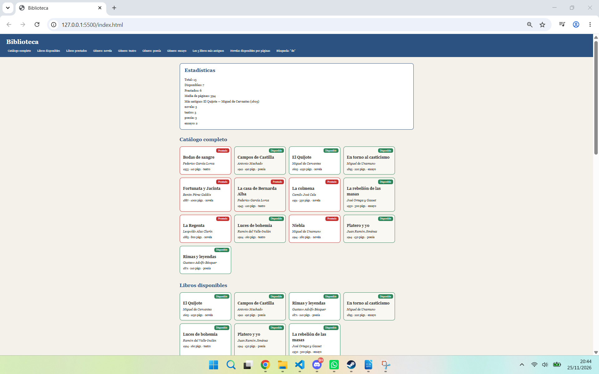
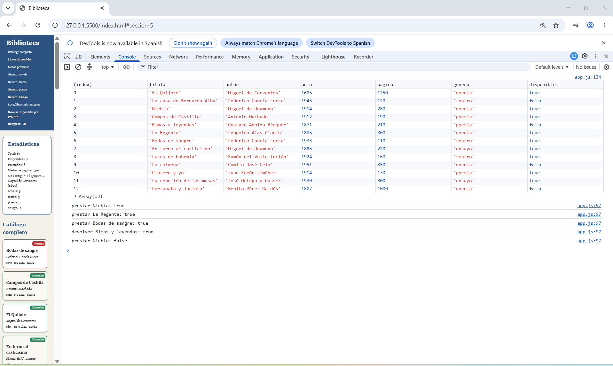
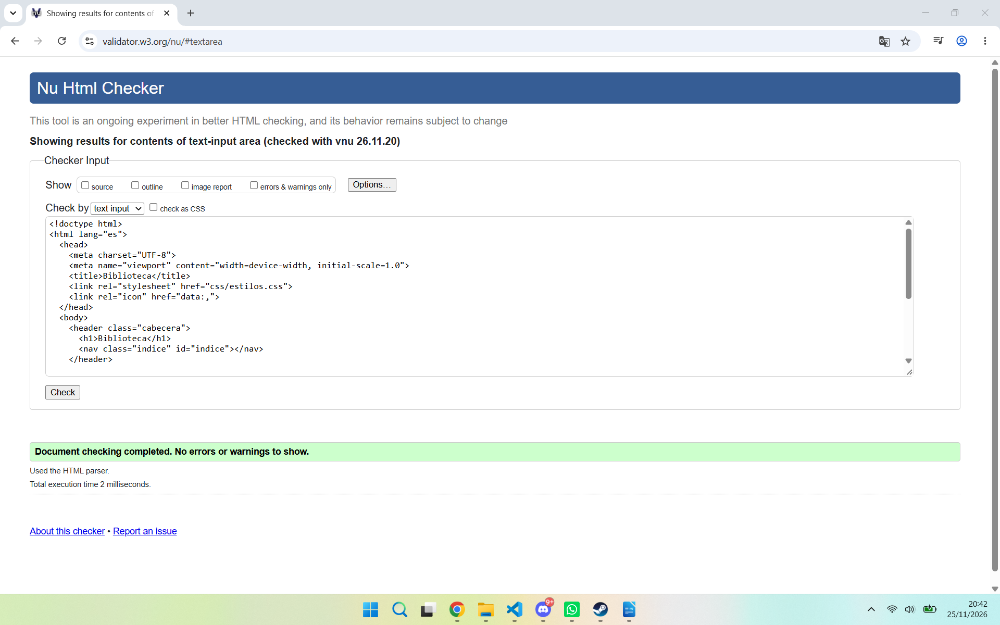

# Biblioteca — DEC + DIW (2º DAW)

Este proyecto es una página web que muestra el catálogo de una biblioteca en varias vistas: catálogo completo, libros disponibles y prestados, una sección por género, los 5 libros más antiguos, una vista combinada (novelas disponibles ordenadas por páginas) y los resultados de una búsqueda. También tiene un índice con enlaces a cada sección y un panel de estadísticas.

## Capturas

Las capturas de la app, consola y el validador se encuentran dentro de la carpeta de capturas:

## Arquitectura

Toda la aplicación se ejecuta en el navegador. Para guardarlos haría falta un servidor con base de datos y una API con la que el cliente pudiese realizar sus peticiones

Se usa JavaScript porque es el único lenguaje que el navegador ejecuta sin necesidad de herramientas externas. En el cliente también existen HTML y CSS, TypeScript (se compila a JavaScript), WebAssembly y frameworks como React, Angular o Vue.

Porque al usar módulos, cada archivo es privado, y para que sean visibles es necesario exportarlos e importarlos donde necesitemos.Además, actúan como si llevaran el atributo defer:, es decir, el navegador ejecuta el script cuando haya leído todo el HTML.

Los módulos no funcionan abriendo el HTML con doble clic, porque el navegador bloquea por seguridad que un archivo local cargue otros archivos, por eso es necesario el uso de Live Server

En el navegador, un lenguaje interpretado lee mi código y lo ejecuta directamente, sin tener que compilarlo antes. Como inconveniente, un programa compilado suele ser más rápido, porque ya está traducido a código máquina antes de ejecutarse. Además, algunos errores no se detectan hasta que el código se ejecuta, y entonces aparecen en la consola.

Herramientas: Visual Studio Code con Live Server, Herramientas para desarrolladores de Chrome para probar y depurar, validador del W3C y GitHub.

## Decisiones

**Cómo combino los filtros.** Los métodos filtrarPorGenero y filtrarPorDisponibilidad devuelven arrays, así que se puede seguir trabajando sobre el resultado. Para la vista «novelas disponibles ordenadas por páginas» filtro primero por género, aplico filter sobre ese resultado para quedarme con las disponibles y ordeno una copia con sort.

**Cómo ordeno sin modificar el array original.** sort() modifica el array sobre el que se llama, así que en ordenarPor primero hago una copia con el operador spread ([...this.libros]) y ordeno esa copia. Para texto uso localeCompare y para números la resta. Para orden descendente intercambio a y b.

**Cómo convierto los campos de texto en cargarDesdeTexto.** Separo el texto en líneas con split("\n") y cada línea en campos con split(";"). Todos los campos llegan como texto, así que convierto año y páginas con Number(...) y el campo si/no en booleano comparando con "si" tras trim() y toLowerCase().
